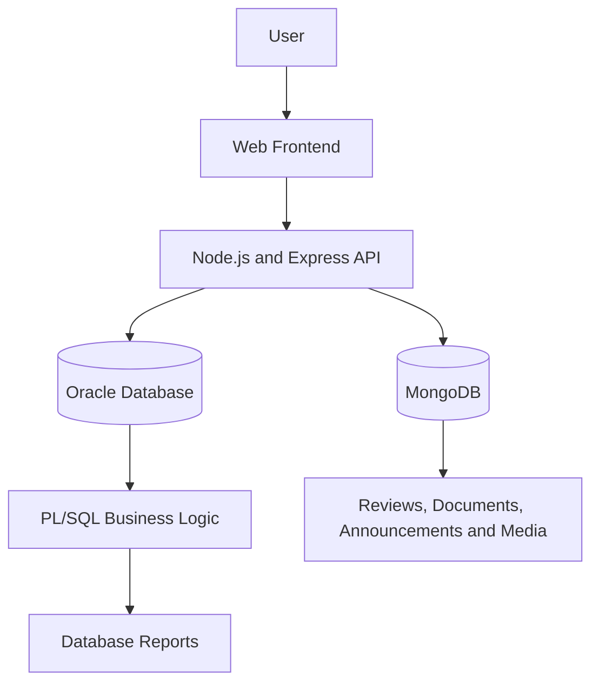

# SmartMove Transport Solutions — Data Management System

A database-driven transport management system developed for the Data Management 2 coursework.


---

## Table of Contents

- [Project Overview](#project-overview)
- [Objectives](#objectives)
- [Main Features](#main-features)
- [Technology Stack](#technology-stack)
- [System Architecture](#system-architecture)
- [Repository Structure](#repository-structure)
- [Prerequisites](#prerequisites)
- [Installation and Setup](#installation-and-setup)
- [Running the Application](#running-the-application)
- [Database Setup](#database-setup)
- [Testing](#testing)
- [Documentation](#documentation)
- [Team Responsibilities](#team-responsibilities)
- [Project Status](#project-status)

## Project Overview

SmartMove Transport Solutions is a transport management system designed to support the management of vehicles, drivers, routes, passengers, trips, bookings, payments, maintenance records, and passenger feedback.

The project uses **Oracle Database** to store structured operational data and **PL/SQL** to implement database operations, validation, automation, and reporting. **MongoDB** stores flexible data such as reviews, vehicle documents, announcements, and trip-related media.

A web interface communicates with a Node.js and Express backend, which provides API endpoints for the database operations.

This project was developed as part of the Data Management 2 coursework.

## Objectives

- Design a relational database for transport management.
- Implement primary keys, foreign keys, constraints, and relationships.
- Use PL/SQL procedures, functions, cursors, triggers, exception handling, and reports.
- Use MongoDB to manage flexible and multimedia-related data.
- Develop a web interface for interacting with transport information.
- Integrate the frontend, backend, Oracle Database, and MongoDB.
- Document the implementation and provide testing evidence.

## Main Features

### Transport management

- Vehicle and driver management
- Route and trip management
- Passenger registration
- Booking creation and cancellation
- Payment management
- Vehicle maintenance tracking
- Passenger feedback

### PL/SQL functionality

- Stored procedures for common transport operations
- Functions for revenue, passenger trip counts, and available seats
- Cursor-based passenger history, route usage, and maintenance queries
- Triggers for database validation and automated rules
- Exception-handling examples
- Reports for revenue, route usage, driver performance, maintenance, and trip occupancy

### MongoDB functionality

- Passenger reviews and feedback
- Vehicle documents and images
- Travel announcements
- Trip-related media
- Search, update, and aggregation operations

### Web application

- Dashboard and transport-management interface
- API endpoints for Oracle database operations
- API endpoints for MongoDB data
- Backend configuration through environment variables

The availability and correctness of individual features must be confirmed through testing.

## Technology Stack

| Technology | Purpose |
|---|---|
| Oracle Database | Stores structured transport data |
| Oracle SQL / SQL Developer | Database creation, queries, and testing |
| PL/SQL | Stored procedures, functions, cursors, triggers, exceptions, and reports |
| MongoDB | Stores flexible and document-oriented data |
| MongoDB Compass / `mongosh` | MongoDB management and query execution |
| HTML | Web page structure |
| CSS | User interface styling |
| JavaScript | Frontend behaviour |
| Node.js | Backend runtime |
| Express.js | HTTP API |
| Git and GitHub | Version control and team collaboration |

## System Architecture



Oracle handles relational transport operations. PL/SQL provides database-side business logic, while MongoDB stores document-oriented data. The Express backend connects the web interface to both databases.

## Repository Structure

```text
SmartMove-Transport---DM2-CW/
│
├── README.md
│
├── oracle/
│   ├── README.md
│   ├── create_tables.sql
│   ├── sample_data.sql
│   └── View.sql
│
├── plsql/
│   ├── README.md
│   ├── procedures.sql
│   ├── functions.sql
│   ├── cursors.sql
│   ├── triggers.sql
│   ├── exceptions.sql
│   ├── reports.sql
│   └── test scripts
│
├── mongodb/
│   ├── README.md
│   ├── create_collections.js
│   ├── insert_data.js
│   ├── queries.js
│   ├── updates.js
│   └── aggregation.js
│
├── application/
│   ├── .env.example
│   ├── package.json
│   ├── server/
│   │   └── index.js
│   └── public/
│       ├── index.html
│       ├── css/
│       │   └── style.css
│       └── js/
│           └── app.js
│
└── documentation/
    └── README.md
```

Additional files, reports, diagrams, screenshots, and coursework evidence may be stored in the relevant directories.

## Prerequisites

Install or prepare the following:

- Oracle Database with a working database user
- Oracle SQL Developer or another compatible Oracle SQL client
- MongoDB Server and MongoDB Compass or `mongosh`
- Node.js and npm
- Git, if cloning the repository

You must have valid Oracle and MongoDB connection details before running the complete application.

## Installation and Setup

### 1. Clone the repository

```bash
git clone https://github.com/chanura-madushan/SmartMove-Transport---DM2-CW.git
cd SmartMove-Transport---DM2-CW
```

### 2. Set up Oracle

1. Open Oracle SQL Developer.
2. Connect using your coursework database account.
3. Open `oracle/create_tables.sql`.
4. Execute the script and check for errors.
5. Open and execute `oracle/sample_data.sql`.
6. Confirm that the tables and sample records exist.

See [Oracle Setup](oracle/README.md) for more details.

### 3. Set up MongoDB

1. Start the MongoDB service.
2. Open `mongosh` or MongoDB Compass.
3. Run the scripts in the `mongodb/` directory in the documented order.
4. Confirm that the `smartmove_transport` database and required collections exist.

See [MongoDB README](mongodb/README.md).

### 4. Configure the application

Open a terminal in the application directory:

```bash
cd application
npm install
```

Create a local `.env` file by copying `.env.example`.

On Windows Command Prompt:

```cmd
copy .env.example .env
```

On PowerShell:

```powershell
Copy-Item .env.example .env
```

Edit `.env` and enter your actual Oracle credentials and connection string. Adjust the MongoDB URI and database name if your setup differs.

**Security:** Never commit real passwords, tokens, or private connection details to GitHub.

### 5. Compile and test PL/SQL

After the Oracle schema and sample data are ready:

1. Execute the PL/SQL scripts in `plsql/`.
2. Check for compilation errors after each script.
3. Run the corresponding test scripts.
4. Confirm the output against the expected results.

See [PL/SQL README](plsql/README.md).

## Running the Application

Ensure that Oracle Database and MongoDB are running and that the `.env` file contains valid settings.

From the `application/` directory, run:

```bash
npm start
```

If the connections succeed, the backend should log the database connection status and the local server address. The default port in `.env.example` is `3000`.

Open the displayed local address in a browser, normally:

```text
http://localhost:3000
```

The server also provides a health endpoint:

```text
http://localhost:3000/api/health
```

A successful startup and a successful health response do not, by themselves, prove that every database operation works. Test the actual application features.

## Database Setup

The repository separates database responsibilities:

| Directory | Responsibility |
|---|---|
| `oracle/` | Relational schema, constraints, and sample data |
| `plsql/` | Stored database logic and reports |
| `mongodb/` | Collections, sample documents, queries, updates, and aggregations |
| `application/` | Web frontend and backend API |

Run scripts using the appropriate database tool. Review dependencies before changing the execution order.

**Note:** `oracle/View.sql` currently contains table inspection queries (`SELECT *`) rather than `CREATE VIEW` definitions.

## Testing

Testing should cover:

- Oracle table creation and constraints
- Sample data insertion
- PL/SQL compilation
- Stored procedure and function outputs
- Cursor results
- Trigger behaviour
- Exception-handling scenarios
- Report output
- MongoDB queries and aggregation results
- Backend health and database connections
- Frontend-to-backend operations
- Error handling for invalid inputs and missing records

Record test cases, expected results, actual results, and screenshots in the coursework documentation. Only mark tests as passed after executing and verifying them.

## Documentation

- [Oracle database setup](oracle/README.md)
- [PL/SQL implementation](plsql/README.md)
- [MongoDB implementation](mongodb/README.md)
- [Coursework documentation and evidence](documentation/README.md)

## Team Responsibilities

The project is organised around the group's main implementation areas:

| Member | Main responsibility |
|---|---|
| Member 1 | Oracle relational database |
| Member 2 | PL/SQL programming and reports |
| Member 3 | MongoDB |
| Member 4 | Web application and integration |

Confirm the final contribution record with the group before submission.

## Project Status

This repository contains the main database scripts, PL/SQL modules, MongoDB scripts, and web application code.

The project should be considered complete only after the components have been compiled, executed, tested, integrated, and documented against the final coursework requirements.

---

**Repository:** [SmartMove Transport Solutions — DM2 Coursework](https://github.com/chanura-madushan/SmartMove-Transport---DM2-CW)

**Academic context:** Data Management 2 coursework.
